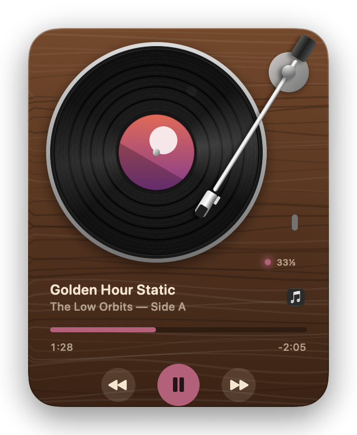
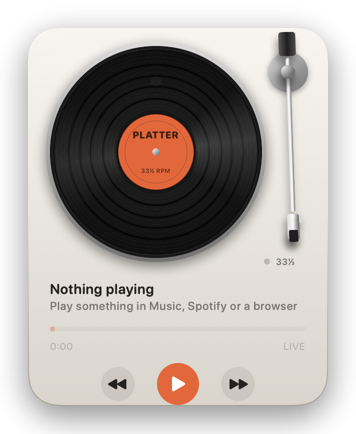
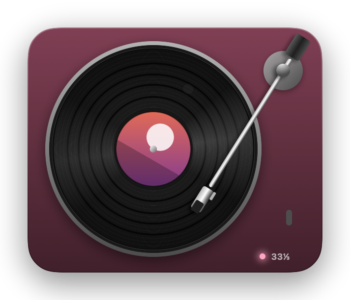

# Platter

A vinyl turntable "now playing" widget for the macOS desktop. Whatever your Mac is playing (Apple Music, Spotify, Safari or Chrome video, Podcasts…) goes on the platter: the album art becomes the record label, the record spins at 33⅓ rpm with real spin-up and spin-down, and the tonearm moves across the grooves as the song plays.

<p align="center">
  
  
</p>
<p align="center">
  
  
</p>

## Using it

| Action | Result |
|---|---|
| Click the record | Play / pause |
| Spin the record by hand | Scrub (one full turn = 15 seconds) |
| Drag the progress bar | Seek |
| Drag the plinth | Move the widget |
| Right-click, or the ◉ menu bar icon | Settings |

**Settings:** Style (Walnut, Midnight, Arctic, Album Colors, which tints the plinth from the cover art), Size (S/M/L), Layout (turntable with controls, or just the record with controls on hover), Position (on the desktop under your windows, or floating above them), and Launch at Login.

## Build

You only need the Xcode Command Line Tools (`xcode-select --install`). Full Xcode isn't required.

```sh
./build.sh                      # → build/Platter.app
cp -R build/Platter.app ~/Applications/
open ~/Applications/Platter.app
```

`Platter --snapshot out.png [walnut|midnight|arctic|album] [full|record] [idle]` renders the widget to a PNG. The screenshots above were made this way.

## How it works

- `Sources/Platter.swift`: the entire app (SwiftUI + AppKit), with a borderless panel and a menu bar item.
- `Adapter/`: reads the system Now Playing session through the private MediaRemote framework. Since macOS 15.4, MediaRemote only answers Apple-signed processes, so the adapter library is loaded into `/usr/bin/perl` (a platform binary) and streams JSON lines back to the app. If that fails, Platter falls back to Apple Events for Music and Spotify.

## License

GPL-3.0-or-later. The Now Playing adapter is adapted from [Vorssaint utils](https://github.com/vorssaint/vorssaint-utils) (GPL-3.0).
