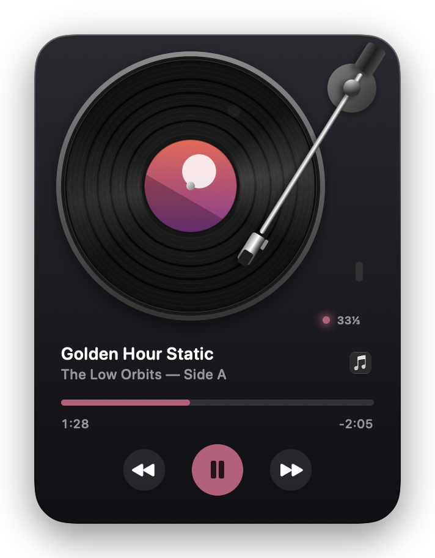

# Platter

A vinyl turntable "now playing" widget for the macOS desktop. Whatever your Mac is playing (Apple Music, Spotify, Safari or Chrome video, Podcasts…) goes on the platter: the album art becomes the record label, the record spins at 33⅓ rpm with real spin-up and spin-down, and the tonearm moves across the grooves as the song plays.

<p align="center">
  
  
</p>
<p align="center">
  
  
</p>

## Desktop widget

Platter also comes with a real macOS desktop widget (WidgetKit) in Small, Medium and Large sizes, so it sits with your other widgets:

1. Open Platter (it lives in the menu bar, ◉).
2. Right-click the desktop → **Edit Widgets…** → search **Platter** → drag a size onto the desktop.
3. Right-click the widget → **Edit "Platter"** to give that widget its own style.

Click the record or the play button to play or pause, and use ◀◀ / ▶▶ to skip. The record turns while music plays and the tonearm tracks the song. Widgets can only redraw every couple of seconds, so the widget's record turns slowly instead of at a true 33⅓ rpm. Platter has to stay running, because it tells the widget what's playing and carries out the widget's buttons.

You can turn off the floating turntable from the menu bar (◉ → Floating Turntable) if you only want the widget.

## Using the floating turntable

| Action | Result |
|---|---|
| Click the record | Play / pause |
| Spin the record by hand | Scrub (one full turn = 15 seconds) |
| Drag the progress bar | Seek |
| Drag the plinth | Move the widget |
| Right-click, or the ◉ menu bar icon | Settings |

**Settings:** Style (Walnut, Midnight, Arctic, Album Colors, which tints the plinth from the cover art), Size (S/M/L), Layout (turntable with controls, or just the record with controls on hover), Position (on the desktop under your windows, or floating above them), and Launch at Login.

## Build

Needs Xcode and [XcodeGen](https://github.com/yonaskolb/XcodeGen) (`brew install xcodegen`).

```sh
./build.sh                      # → build/Platter.app (app + widget extension)
cp -R build/Platter.app ~/Applications/
open ~/Applications/Platter.app
```

`Platter --snapshot out.png [walnut|midnight|arctic|album] [full|record] [idle]` renders the widget to a PNG. The screenshots above were made this way.

## How it works

- `App/main.swift`: the menu bar app and the floating turntable (SwiftUI + AppKit).
- `Widget/PlatterWidget.swift`: the WidgetKit widget. It is sandboxed, so the app writes what's playing to `~/Library/Application Support/Platter/` and the widget reads it. The widget's buttons send Darwin notifications back to the app.
- `Shared/Look.swift`: the skins, turntable drawing and state file, shared by the app and the widget.
- `Adapter/`: reads the system Now Playing session through the private MediaRemote framework. Since macOS 15.4, MediaRemote only answers Apple-signed processes, so the adapter library is loaded into `/usr/bin/perl` (a platform binary) and streams JSON lines back to the app. If that fails, Platter falls back to Apple Events for Music and Spotify.

## License

GPL-3.0-or-later. The Now Playing adapter is adapted from [Vorssaint utils](https://github.com/vorssaint/vorssaint-utils) (GPL-3.0).
